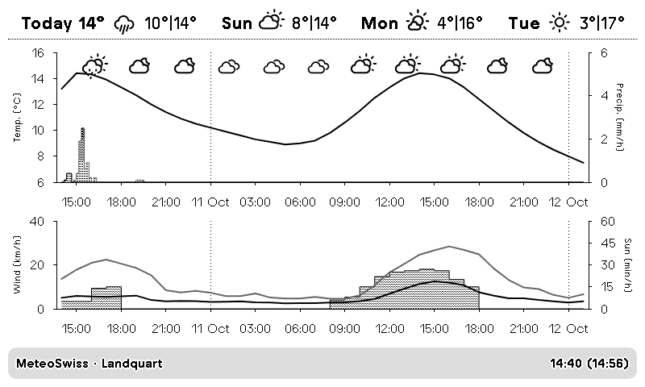

# MeteoSwiss Charts Plugin for TRMNL

A weather chart board for [TRMNL](https://trmnl.com) that shows the detailed MeteoSwiss forecast for a Swiss location on
your e-ink display.

  

## Overview

This plugin fetches the forecast of [MeteoSwiss](https://www.meteoswiss.admin.ch/), Switzerland's official weather
service, and draws it as charts similar to the ones in the MeteoSwiss app:

- **Daily forecast** - weather icon with minimum and maximum temperature for today and the following days, plus the
  current temperature
- **Temperature** - hourly curve with a weather icon every 3 hours
- **Precipitation** - bars in 10-minute steps for the next hours, then hourly, shaded by intensity, with an outline for
  the possible maximum
- **Wind** - hourly mean wind speed and gusts
- **Sunshine** - minutes of sunshine per hour
- **Freshness** - the title bar shows when the forecast was issued and, in parentheses, when the screen was drawn

All four TRMNL layouts are supported. The full layout covers the next 36 hours with a 4-day forecast, the half layouts
cover 26 hours, and the quadrant layout shows a 2-day forecast with the temperature and precipitation chart only.

## How to Use

1. Install via: https://trmnl.com/recipes/62668
2. Configure the plugin:

   | Field         | Description                             | Example  |
   | ------------- | --------------------------------------- | -------- |
   | Postal code   | Swiss postal code (PLZ) of the location | 1003     |
   | Location name | Name shown in the title bar             | Lausanne |

3. Add the plugin to a playlist and choose your preferred layout

The postal code must be one that MeteoSwiss knows as a locality. Codes reserved for PO boxes or companies, such as 1000
or 3000, return no data.

## Manual Installation

The plugin sources live in `src/`, in the layout used by TRMNL's GitHub sync and by
[trmnlp](https://github.com/usetrmnl/trmnlp). To run your own copy as a private plugin, create a new private plugin on
TRMNL with the **Polling** strategy and copy the files into it:

| File                                                  | Where it goes                                     |
| ----------------------------------------------------- | ------------------------------------------------- |
| `src/settings.yml`                                    | Polling URL (`polling_url`) and the custom fields |
| `src/shared.liquid`                                   | Shared markup                                     |
| `src/full.liquid`, `src/half_horizontal.liquid`, etc. | Markup of the corresponding layout                |

## Data Source

Weather data is provided by [MeteoSwiss](https://www.meteoswiss.admin.ch/), through the API used by the MeteoSwiss app.
Charts are drawn with [Highcharts](https://www.highcharts.com/) and the weather symbols are the
[Weather Icons](https://erikflowers.github.io/weather-icons/) hosted by TRMNL.

This plugin is not affiliated with or endorsed by MeteoSwiss.

## License & Contribution

Released under the [MIT License](LICENSE).

If you find bugs or have improvements, feel free to open an issue or send a pull request.
